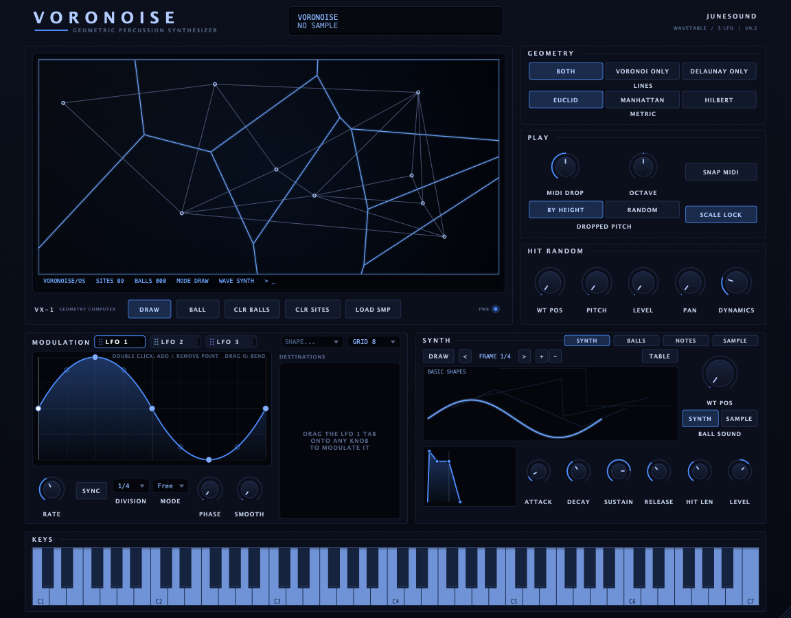

# Voronoise



Voronoise is a geometric percussion synth (VST3 and standalone). You place sites on the screen, and they form Voronoi and Delaunay lines that balls bounce off. Every bounce plays a note through the built-in wavetable or sample engine, and three LFOs can modulate any knob.

## Build

You need CMake 3.22+ and a C++23 compiler. JUCE and GoogleTest are downloaded automatically on the first configure.

```bash
cmake -S . -B build -DCMAKE_BUILD_TYPE=Release
cmake --build build
```

The VST3 and standalone app end up in `build/plugin/Voronoise_artefacts/Release/`. To run the tests, run `./build/test/VoronoiseTests`.
